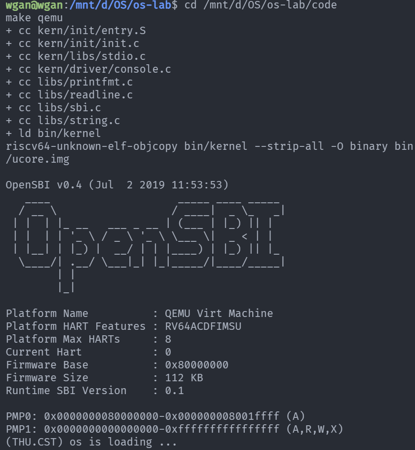
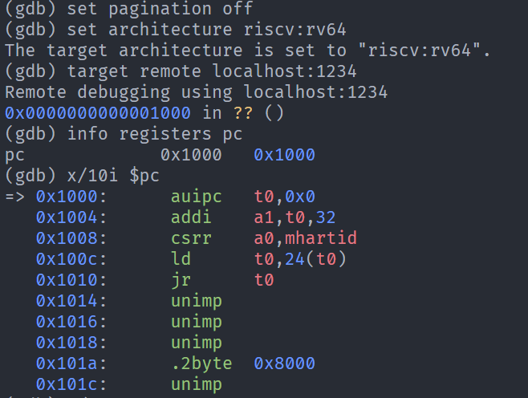
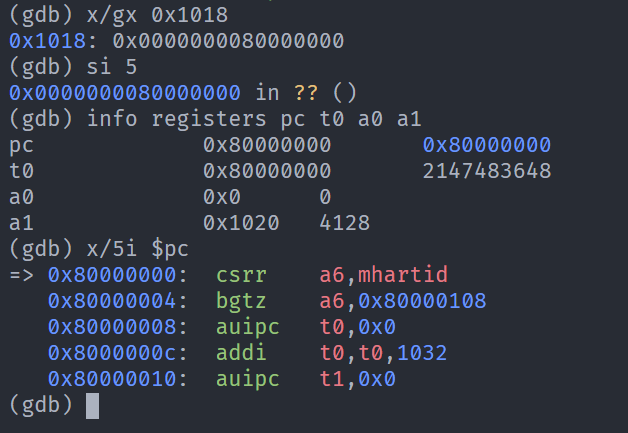
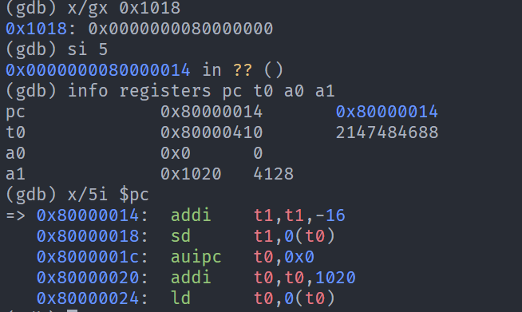
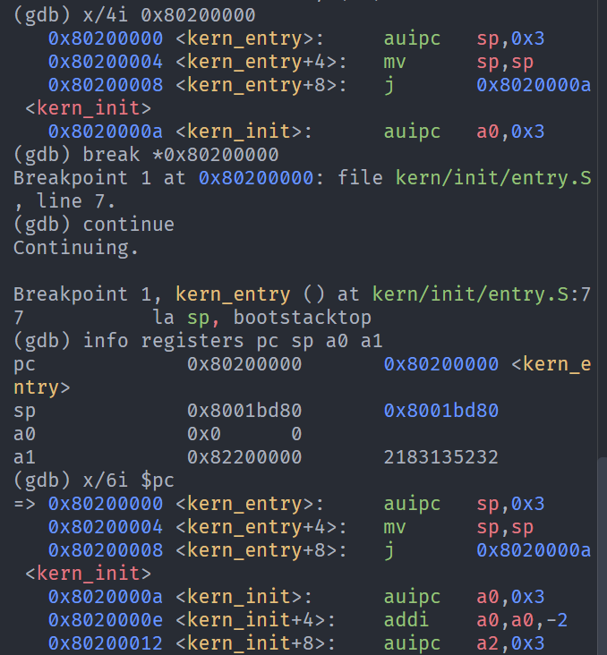
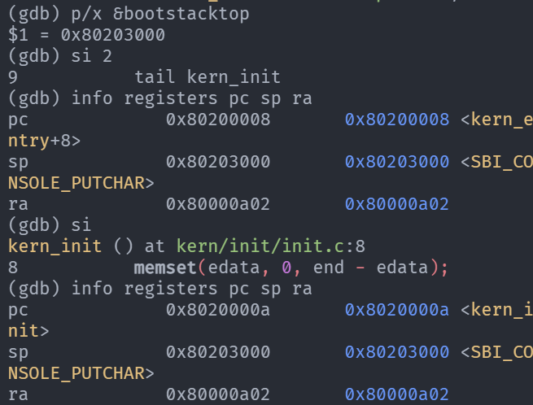

# 操作系统实验报告

## 实验基本信息

| 项目 | 内容 |
|------|------|
| **实验名称** | Lab1：比麻雀更小的麻雀（最小可执行内核） |
| **小组成员** | 2411127—王淦 |
| **完成日期** | 2026-10-010 |
| **提交分支** | `lab1` |
| **小组仓库** | <https://github.com/stalwgann/os-lab.git> |


---

## 一、实验目的

实验1主要讲解最小可执行内核和启动流程。我们的内核主要在 Qemu 模拟器上运行，它可以模拟一台 64 位 RISC-V 计算机。为了让我们的内核能够正确对接到 Qemu 模拟器上，需要了解 Qemu 模拟器的启动流程，还需要一些程序内存布局和编译流程（特别是链接）相关知识。

本次实验沿用课程提供的最小内核源码，重点记录对已有代码的理解、两个练习的解答以及实际运行和调试结果。

---

## 二、实验环境

| 项目 | 实验环境 |
|------|----------|
| 主机与开发环境 | Windows，WSL Ubuntu 22.04 |
| 目标平台 | QEMU `virt`，64 位 RISC-V |
| 交叉编译器 | `riscv64-unknown-elf-gcc` 10.2.0 |
| 模拟器 | QEMU 4.1.1 |
| AI 辅助工具 | Codex |
| 底层模型 | GPT-6.1 Sol |


---

## 三、实验整体逻辑分析

### 3.1 本章节的逻辑主线

我们对本章主线的理解是：先让内核具有正确的内存布局和入口，再建立执行 C 代码所需的基本环境，最后完成最简单的输出功能，以此验证内核已经开始工作。

本次实验从汇编入口、链接布局和固件服务入手，构建一个可以独立启动的最小程序。

### 3.2 功能组织和执行顺序

**确定链接布局并生成镜像。** 链接脚本设置内核入口和各段的位置。交叉编译器将 C 与汇编源码生成 RISC-V 目标文件，链接器生成 ELF 文件，`objcopy` 再将 ELF 转换成原始二进制镜像。加载位置必须与代码布局、固件交接位置配合，才能让 CPU 取到正确的第一条内核指令。

**完成从固件到内核的启动交接。** QEMU 模拟 CPU 从复位地址开始执行启动跳板，随后进入 OpenSBI。OpenSBI 初始化运行环境后，将执行权交给内核入口 `kern_entry`。固件阶段先于内核阶段，为内核提供必要的运行环境和底层服务。

**在汇编入口建立内核栈。** `kern_entry` 设置 `sp`，再跳转到 `kern_init`。因为 C 函数可能使用栈保存寄存器和局部变量，栈必须在进入 C 代码前准备好。

**进入 C 入口后初始化数据并输出文字。** `kern_init` 清零 BSS，保证未显式初始化的全局和静态数据具有零初值；随后调用 `cprintf`，通过格式化代码、控制台封装和 SBI 服务输出启动文字。

**最终停留在无限循环，并通过调试验证内部流程。** 当前内核输出后进入空循环。GDB 用于确认复位地址、固件入口、内核入口以及栈和返回地址的变化，使验证不限于观察一行启动文字。


| 阶段 | 地址 | 作用 |
|----------|----------------|----------|
| 复位跳板 MROM | `0x1000` | 准备启动参数，读取固件入口并跳转 |
| OpenSBI | `0x80000000` | 初始化运行环境，提供 SBI 服务并交接执行权 |
| 汇编入口 `kern_entry` | `0x80200000` | 设置内核栈，跳转到 C 入口 |
| C 入口 `kern_init` | `0x8020000a` | 清零 BSS、输出启动文字、进入无限循环 |


---

## 四、实验内容与代码理解

### 4.1 练习 1：理解内核启动中的程序入口操作

`kern/init/entry.S` 中的核心入口代码为：

```asm
kern_entry:
    la sp, bootstacktop
    tail kern_init
```

#### `la sp, bootstacktop` 的操作与目的

`la` 是加载地址的伪指令，将 `bootstacktop` 符号对应的地址写入栈指针寄存器 `sp`。它加载的是栈顶地址。

目的是建立内核自己的栈，为后续 C 函数运行提供有效的栈空间。

启动栈由同一汇编文件预留：

```asm
.section .data
.align PGSHIFT
bootstack:
    .space KSTACKSIZE
bootstacktop:
```

`mmu.h` 定义 `PGSIZE = 4096`、`PGSHIFT = 12`；`memlayout.h` 定义启动栈为两页。因此 `.align PGSHIFT` 表示按 4096 字节对齐，`.space KSTACKSIZE` 预留 8192 字节。`bootstack` 是这片空间的起始位置，`bootstacktop` 是结束位置。

实际调试中，进入内核入口时 `sp = 0x8001bd80`，仍是固件留下的栈指针；`p/x &bootstacktop` 得到 `0x80203000`。执行设置栈的指令后，`sp` 变为 `0x80203000`，与栈顶地址相同，验证了内核栈的建立。

#### `tail kern_init` 的操作与目的

`tail` 是尾调用伪指令，将控制流转移到 `kern_init`，不为此次跳转写入新的返回地址。普通 `call` 通常会将返回位置写入 `ra`，但 `kern_init` 不会正常返回，汇编入口也没有需要在调用后继续执行的逻辑，所以这里使用尾调用完成交接。

实际入口指令：

```asm
0x80200000 <kern_entry>:   auipc sp,0x3
0x80200004 <kern_entry+4>: mv    sp,sp
0x80200008 <kern_entry+8>: j     0x8020000a <kern_init>
```

这里前两条完成本次 `la` 的效果，最后一条是 `tail` 优化后的跳转。执行 `si 2` 后 PC 为 `0x80200008`，再执行一次 `si` 后进入 `kern_init`，PC 为 `0x8020000a`。跳转前后 `ra` 均为 `0x80000a02`，证明此次跳转没有改写返回地址。

### 4.2 练习 2：使用 GDB 验证启动流程

#### 上电后最初执行的指令位于什么地址？

在本实验的 QEMU `virt` 配置中，连接暂停的模拟 CPU 后，GDB 显示 PC 为 `0x1000`。最初指令位于该地址开始的 MROM 复位跳板。

观察到的前五条指令如下：

| 地址 | 指令 | 主要作用 |
|------|------|----------|
| `0x1000` | `auipc t0,0x0` | 当前指令地址加零，得到 `t0 = 0x1000` |
| `0x1004` | `addi a1,t0,32` | 得到 `a1 = 0x1020`，准备设备树地址参数 |
| `0x1008` | `csrr a0,mhartid` | 取得硬件线程编号作为启动参数，本次为 0 |
| `0x100c` | `ld t0,24(t0)` | 从 `0x1018` 读取 64 位跳转目标 |
| `0x1010` | `jr t0` | 跳转到读出的固件入口 |

`x/gx 0x1018` 的结果为 `0x0000000080000000`。从复位位置执行最初五条指令后，入口截图中 PC 和 `t0` 都为 `0x80000000`，`a0 = 0`、`a1 = 0x1020`，验证了复位跳板到 OpenSBI 的跳转。另一次记录停止在 OpenSBI 内部的 `0x80000014`。

反汇编前五条之后还显示了一些 `unimp` 等项，其中包含数据被当成指令解释的结果。CPU 已在 `jr t0` 处跳转，不能认为它会沿此路径继续顺序执行这些数据。

#### 主要完成哪些功能？

这些指令主要准备启动参数，并将执行权交给 OpenSBI：获取当前地址、设备树指针和硬件线程编号，读取固件入口地址，然后跳转。

继续执行固件后，`0x80200000` 处的断点命中 `kern_entry`，GDB 定位到 `entry.S` 中的 `la sp, bootstacktop`。此时停在内核第一条指令即将执行的位置，证明固件已把执行权交给内核。随后对栈和跳转的单步结果与练习 1 的分析一致。


### 4.3 链接布局与镜像生成模块的理解

`tools/kernel.ld` 使用 `OUTPUT_ARCH(riscv)` 指定输出架构，使用 `ENTRY(kern_entry)` 设置 ELF 入口，并通过 `BASE_ADDRESS = 0x80200000` 及 `SECTIONS` 安排内核各段的位置。链接脚本的作用是组织代码和数据的地址布局，而不是代替启动代码执行初始化。

| 区域 | 主要内容及作用 |
|------|----------------|
| `.text` | 机器指令，即程序要执行的代码 |
| `.rodata` | 只读数据，例如启动消息字符串 |
| `.data`、`.sdata` | 有初始值的可写数据；本实验启动栈在 `.data` 中预留 |
| `.bss` 及相关输入段 | 未初始化或零初始化的全局、静态数据，需要运行时保证零初值 |

`Makefile` 和 `tools/function.mk` 管理源文件、依赖关系和构建规则，调用 RISC-V 工具链编译 C 与汇编，链接为 `bin/kernel`，再通过 `objcopy --strip-all -O binary` 生成 `bin/ucore.img`。交叉编译的原因是开发环境的主机架构与模拟执行的 RISC-V 目标架构不同。

两个文件区别的理解是：ELF 是带结构信息的文件，可以描述入口、各段及符号等内容，本次还保留了调试信息，适合 GDB 使用；原始镜像没有完整 ELF 头和符号结构，适合按约定地址直接放入内存。BSS 通常描述空间大小，不需要为整片零值存储文件内容。

`ENTRY(kern_entry)` 设置 ELF 入口，但并不说明 CPU 上电就从这里执行。它仍先执行复位和固件阶段；链接布局、镜像加载位置与固件交接目标需要配合，才能到达正确的内核入口。

### 4.4 C 入口与数据初始化的理解

`kern/init/init.c` 中的主要逻辑为：

```c
extern char edata[], end[];
memset(edata, 0, end - edata);

const char *message = "(THU.CST) os is loading ...\n";
cprintf("%s\n\n", message);
while (1)
    ;
```

`edata` 和 `end` 由链接脚本提供，用于标记已初始化数据之后的位置以及 BSS 结束位置。`extern` 声明让 C 代码引用这些符号，并没有在此重新分配两个数组。二者相减得到待清零区域的字节数，`libs/string.c` 中的 `memset` 按字节写入零。

清零的目的是满足 C 语言对未显式初始化的全局、静态对象的零初值要求。

随后 `cprintf` 输出启动信息，最后的无限循环使内核留在当前执行阶段，避免返回或继续执行无后续安排的内容。这个空循环不等于 CPU 休眠或关机。函数声明中的 `noreturn` 是对编译器的说明，真正使函数不返回的是实际执行逻辑。

### 4.5 格式化输出与 SBI 模块的理解

本实验的 `stdio.h`、格式化代码和字符串函数来自源码中的自带库，输出功能分为格式化、单字符输出封装和固件服务三个层次。

| 核心函数 | 对功能的理解 |
|----------|--------------|
| `cprintf` | 接收格式字符串与可变参数，用 `va_start` 等机制组织参数 |
| `vcprintf` | 调用格式化函数，并通过计数器累计输出字符数 |
| `vprintfmt` | 解析 `%s`、`%d`、`%x` 等格式，通过回调输出字符 |
| `cputch` | 输出一个字符并增加计数 |
| `cons_putc` | 将字符输出转交给 SBI 封装 |
| `sbi_console_putchar` | 请求固件输出指定字符 |
| `sbi_call` | 按约定设置寄存器，执行 `ecall`，取回返回值 |

当 `cprintf` 遇到 `%s` 时，格式化函数取得字符串指针，逐个字符调用输出回调。这样，高层不需要了解具体硬件，低层也不需要解析格式字符串；格式化逻辑还能被其他输出目标复用，例如写入字符串缓冲区。

本实验中，服务编号 `1` 放入 `a7`（`x17`），字符参数放入 `a0`（`x10`），其余参数按封装放入 `a1`、`a2`。`ecall` 发起环境调用，请求机器模式下的 SBI 服务，返回值通过 `a0` 取回。

SBI 是接口约定，OpenSBI 是它的一种实现。内核在 S 模式下通过该接口请求 M 模式固件的服务。`ecall` 本身不直接打印文字，真正的操作由服务编号、参数和固件处理逻辑共同决定。

---

## 五、测试与验证

### 5.1 结果汇总

| 验证项目 | 实际结果 |
|----------|----------|
| 编译、链接与镜像生成 | `make qemu` 完成构建并启动 QEMU |
| 内核基本输出 | 终端显示 `(THU.CST) os is loading ...` |
| CPU 复位位置 | PC 为 `0x1000` |
| 固件跳转目标 | `0x1018` 保存的 64 位值为 `0x80000000` |
| OpenSBI 入口 | PC 为 `0x80000000` 的入口截图已记录 |
| 内核第一条指令 | 命中 `0x80200000` 处的 `kern_entry` 断点 |
| 内核栈初始化 | `sp` 与 `&bootstacktop` 均为 `0x80203000` |
| 进入 C 入口 | PC 为 `0x8020000a`，跳转前后 `ra` 均为 `0x80000a02` |


### 5.2 编译与运行

截图显示编译、链接、镜像转换、OpenSBI v0.4 启动信息和内核输出，证明该最小内核能够被构建和启动。



### 5.3 复位地址与启动跳板



### 5.4 OpenSBI 入口及内部停止位置



下面是另一次停在 OpenSBI 内部 `0x80000014` 的补充记录。两图分别反映不同的停止状态，不混写为同一个位置。



### 5.5 内核入口断点



### 5.6 内核栈与尾调用




---

## 六、实验总结

### 6.1 本实验的重要知识点及与 OS 原理的关系

| 实验知识点 | 对应 OS 原理知识点 | 含义、关系和差异 |
|------------|-------------------|------------------|
| MROM、OpenSBI 与内核入口 | 操作系统引导 | 引导的核心是建立执行环境并逐级交接控制权。本次观察模拟平台的固件交接；真实 PC 可能使用 UEFI、独立引导程序和磁盘加载，实现更复杂，但层次思想相通 |
| 链接脚本、ELF 与原始镜像 | 程序装载与内存布局 | 链接决定代码和数据的布局，加载使其位于预期位置。本实验采用固定布局，尚未实现应用程序的动态装载、重定位或地址空间隔离 |
| 启动栈与 `sp` | 函数调用和运行时环境 | 栈用于局部数据、寄存器保存及调用状态。本实验只静态预留一个启动栈，尚未涉及每个进程的内核栈或切换 |
| BSS 清零 | 程序初始化和数据语义 | 清零保证静态存储期对象的初值。本实验由内核自己完成，普通应用通常由加载器或启动代码配合完成 |
| SBI、`ecall` 与特权级 | 异常、系统调用和保护机制 | 环境调用通过受控异常转移请求服务。本实验是 S 模式内核请求 M 模式固件服务；用户程序向内核请求系统调用的思想类似，但调用双方和接口层次不同 |
| 格式化输出与控制台封装 | 分层设计和设备抽象 | 高层处理输出格式，低层负责字符传输，降低对硬件细节的依赖。本实验借助 OpenSBI，没有自行实现完整串口驱动 |
| GDB 断点、单步与寄存器观察 | 执行状态与控制流分析 | 通过 PC、SP、RA 验证入口、栈与跳转行为。启动文字可以证明基本输出成功，寄存器和断点则提供更具体的执行证据 |

内核不是自动拥有运行条件的特殊程序，它仍需要正确的入口、数据布局和栈；固件和启动代码把这些条件逐步建立起来。

最小内核的输出简单，但已连接了构建、装载、控制流交接和服务调用这些基础环节。

### 6.2 OS 原理中重要但本实验尚未涉及的知识点

1. **进程、线程和 CPU 调度。** 本实验只有初始化后的无限循环，没有进程创建、调度队列、上下文切换或调度策略。
2. **分页与虚拟内存。** 尚未建立页表、虚拟地址映射、地址空间隔离或缺页处理，也没有实现内存分配器。
3. **内核自身的完整中断与异常处理。** 使用 SBI 服务不等于已经实现内核的异常入口、现场保存、分派和返回机制。
4. **完整设备驱动与 I/O 管理。** 这里只借助固件输出字符，没有构建完整的驱动框架和 I/O 调度。


